# CMPE 273 – Async Messaging with RabbitMQ

A small order-processing system: an **Order Producer** publishes order messages to a RabbitMQ queue, and two **Order Worker** processes consume them as competing consumers. Workers ACK only after processing, survive a crash-before-ACK via redelivery, and skip duplicate `event_id`s (idempotent handling).

**Language:** Python 3 (`pika`) · **Broker:** RabbitMQ 3 (Docker)

## Repository layout

| File | Purpose |
|---|---|
| `docker-compose.yml` | Runs RabbitMQ + management UI |
| `common.py` | Shared connection, queue declaration (`orders`, durable), logging |
| `producer.py` | Publishes orders: `event_id`, `order_id`, `item_id`, `quantity` |
| `worker.py` | Consumes, logs, processes, ACKs; dedup + crash simulation |
| `evidence/` | Raw terminal logs for every scenario |
| `screenshots/` | Terminal screenshots from the run |

## Architecture

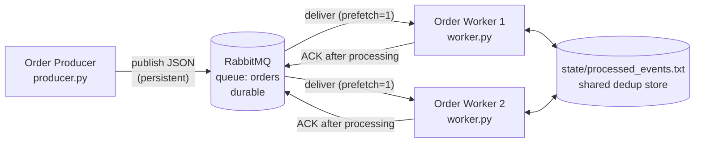

```
                         +-----------------------+
                         |   RabbitMQ broker     |
 [ Order Producer ] ---> |   queue: "orders"     | ---> [ Worker 1 ] --+
     (publish)           |   (durable)           | ---> [ Worker 2 ] --+--> state/processed_events.txt
                         +-----------------------+   <--- ACK ----      (shared event_id store)
```

Key design choices:

- **`auto_ack=False`, manual `basic_ack` after the business action** – a message is only removed from the queue once it is fully processed.
- **`prefetch_count=1`** – each worker holds at most one unacked message, so work is spread fairly and a crash only affects one message.
- **Durable queue + persistent messages** – messages survive a broker restart.
- **Shared dedup file + per-event file lock** – both worker processes check the same `processed_events.txt`, so a duplicate is caught even when it lands on the *other* worker. The `flock` on `state/locks/<event_id>.lock` stops two copies of the same event from being processed at the same instant, and the OS releases it automatically if the worker dies.

## How to run

### 1. Start RabbitMQ

```bash
docker compose up -d
docker compose ps          # wait until rabbitmq shows "healthy"
```

Management UI: <http://localhost:15672> (user `guest`, password `guest`).

### 2. Install Python dependencies

```bash
python3 -m venv .venv
source .venv/bin/activate
pip install -r requirements.txt
```

### 3. Start two workers (two separate terminals)

```bash
# Terminal 1
python worker.py --name worker-1
# Terminal 2
python worker.py --name worker-2
```

### 4. Publish orders (third terminal)

```bash
python producer.py --count 6
```

### Other commands

```bash
python producer.py --count 3 --duplicate        # re-sends the 1st order with the same event_id
python worker.py --name worker-1 --crash-before-ack --work-seconds 4   # crash demo
python producer.py --purge                      # empty the queue
rm -rf state/                                   # reset dedup store between demos
docker exec rabbitmq rabbitmqctl list_queues name messages_ready messages_unacknowledged
docker compose down                             # stop RabbitMQ
```

## Results

All output below is from a real run on macOS (Docker Desktop + RabbitMQ 3). Full logs are in [`evidence/`](evidence/).

### 1. Successful message processing

The producer published 6 orders:

```
22:32:20.428 [producer] PUBLISHED event_id=9ad9db6a order_id=ORD-7441 item_id=SKU-COFFEE quantity=5
22:32:20.428 [producer] PUBLISHED event_id=e3f55b5f order_id=ORD-7332 item_id=SKU-BANANA quantity=3
22:32:20.428 [producer] PUBLISHED event_id=425ad45a order_id=ORD-9770 item_id=SKU-BANANA quantity=2
22:32:20.428 [producer] PUBLISHED event_id=7c47b084 order_id=ORD-8911 item_id=SKU-BANANA quantity=1
22:32:20.428 [producer] PUBLISHED event_id=380cae0e order_id=ORD-4453 item_id=SKU-APPLE quantity=4
22:32:20.428 [producer] PUBLISHED event_id=71038b17 order_id=ORD-9660 item_id=SKU-COFFEE quantity=3
22:32:20.428 [producer] Done. 6 message(s) sent to queue 'orders'
```

Each order is received, logged, processed, then ACKed only after processing finishes:

```
22:32:20.448 [worker-1] RECEIVED event_id=9ad9db6a order_id=ORD-7441 item_id=SKU-COFFEE qty=5 delivery_tag=1 redelivered=False
22:32:20.452 [worker-1] PROCESSING order_id=ORD-7441: reserving 5 x SKU-COFFEE ...
22:32:21.457 [worker-1] DONE + ACKED event_id=9ad9db6a order_id=ORD-7441
```

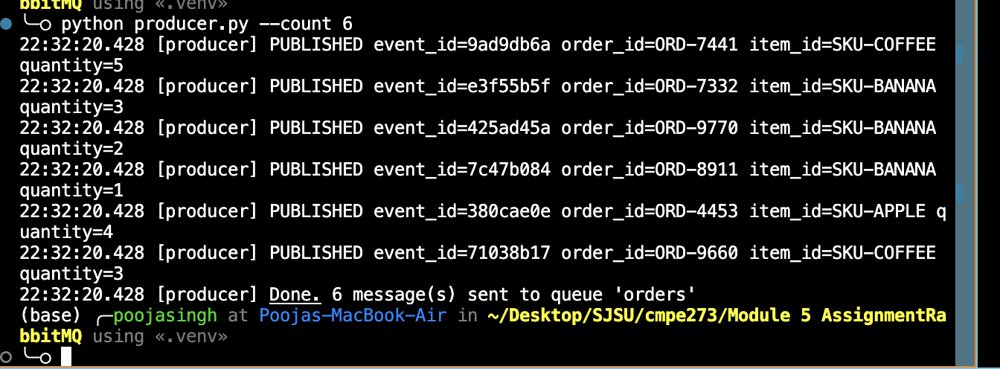

### 2. Two competing consumers

Both workers consumed from the same `orders` queue. The 6 orders were split **3 / 3** and **no order was handled by both workers**:

| Worker | Orders handled |
|---|---|
| worker-1 | ORD-7441, ORD-9770, ORD-9660 |
| worker-2 | ORD-7332, ORD-8911, ORD-4453 |

| worker-1 | worker-2 |
|---|---|
| 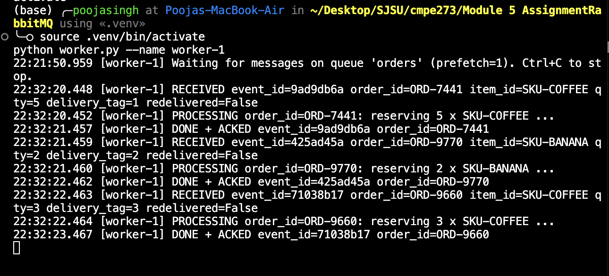 | 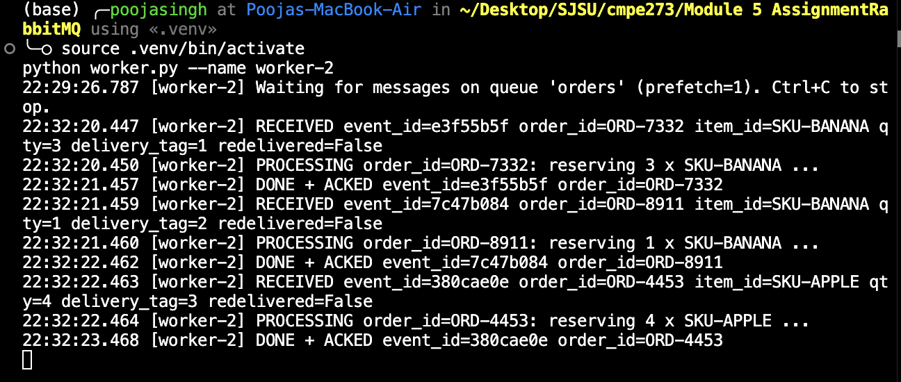 |

### 3. Failure and redelivery

**a) The first worker receives the message.** worker-1 was started alone with `--crash-before-ack --work-seconds 30`, then one order was published:

```
22:40:42.625 [worker-1] RECEIVED event_id=2833c3d4 order_id=ORD-1840 item_id=SKU-BANANA qty=2 delivery_tag=1 redelivered=False
22:40:42.626 [worker-1] PROCESSING order_id=ORD-1840: reserving 2 x SKU-BANANA ...
```

**b) The message is not acknowledged.** While worker-1 was processing, the broker showed it as delivered but unacked:

```
name    messages_ready  messages_unacknowledged
orders  0               1
```

worker-1 then exited abruptly (`os._exit(1)`, equivalent to `kill -9`) **without sending an ACK**:

```
22:41:12.631 [worker-1] SIMULATED CRASH before ACK for event_id=2833c3d4 -> exiting now, NO ACK sent
```

When worker-1's connection dropped, RabbitMQ returned the message to the queue. It was not lost:

```
name    messages_ready  messages_unacknowledged
orders  1               0
```

**c) Another worker receives the message again.** worker-2 started and immediately got the **same `event_id`**, flagged `redelivered=True`, and completed it:

```
22:42:47.035 [worker-2] RECEIVED event_id=2833c3d4 order_id=ORD-1840 item_id=SKU-BANANA qty=2 delivery_tag=1 redelivered=True
22:42:47.035 [worker-2] PROCESSING order_id=ORD-1840: reserving 2 x SKU-BANANA ...
22:42:48.043 [worker-2] DONE + ACKED event_id=2833c3d4 order_id=ORD-1840
```

**The system remained running:** worker-2 stayed up, worker-1 was restarted normally (22:44:38), and both went on to process the next batch of orders in section 4.

| Unacked while processing | worker-1 crashes, no ACK | Message requeued |
|---|---|---|
| 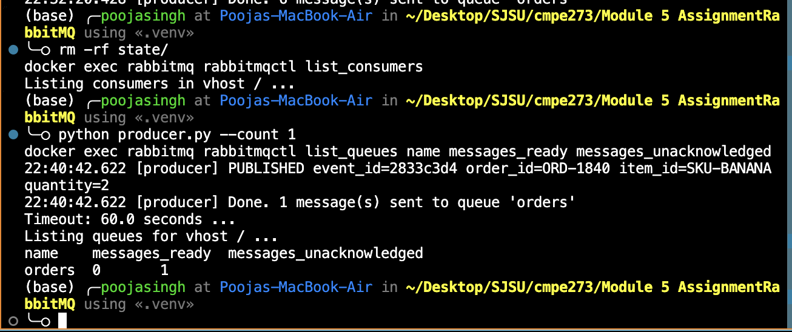 | 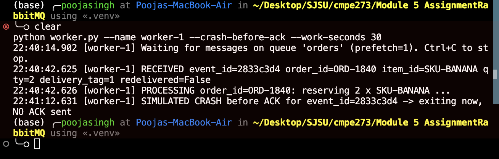 | 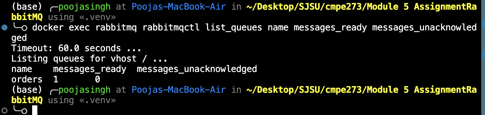 |

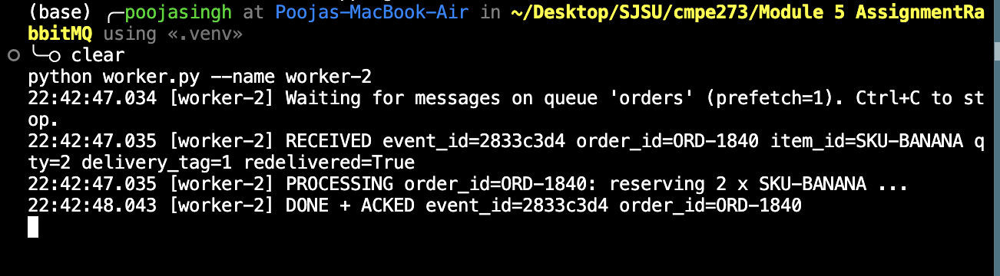

### 4. Duplicate handling

`producer.py --count 3 --duplicate` published 3 orders, then re-sent ORD-8077 with the **same `event_id=ce2525e7`**:

```
22:50:16.198 [producer] PUBLISHED event_id=ce2525e7 order_id=ORD-8077 item_id=SKU-MILK quantity=3
22:50:16.199 [producer] PUBLISHED event_id=e0d434dd order_id=ORD-3597 item_id=SKU-BREAD quantity=5
22:50:16.199 [producer] PUBLISHED event_id=54142c62 order_id=ORD-9409 item_id=SKU-APPLE quantity=1
22:50:16.199 [producer] PUBLISHED (DUPLICATE re-send) event_id=ce2525e7 order_id=ORD-8077 item_id=SKU-MILK quantity=3
22:50:16.199 [producer] Done. 4 message(s) sent to queue 'orders'
```

worker-2 processed the original:

```
22:50:16.201 [worker-2] RECEIVED event_id=ce2525e7 order_id=ORD-8077 item_id=SKU-MILK qty=3 delivery_tag=2 redelivered=False
22:50:16.203 [worker-2] PROCESSING order_id=ORD-8077: reserving 3 x SKU-MILK ...
22:50:17.208 [worker-2] DONE + ACKED event_id=ce2525e7 order_id=ORD-8077
```

The copy landed on **worker-1**, which checked the shared `state/processed_events.txt`, found the `event_id`, and skipped the business action:

```
22:50:17.209 [worker-1] RECEIVED event_id=ce2525e7 order_id=ORD-8077 item_id=SKU-MILK qty=3 delivery_tag=2 redelivered=False
22:50:17.210 [worker-1] DUPLICATE detected event_id=ce2525e7 order_id=ORD-8077 -> skipping business action
22:50:17.210 [worker-1] ACKED duplicate event_id=ce2525e7 (removed from queue, no side effects)
```

4 messages in, **3 business actions out**. This also shows why the dedup store is shared: the duplicate arrived at a *different* process than the original, so a per-process in-memory set would have missed it.

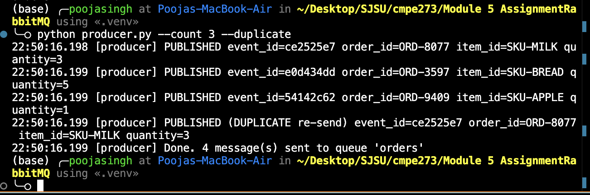

| worker-2 (original) | worker-1 (duplicate skipped) |
|---|---|
| 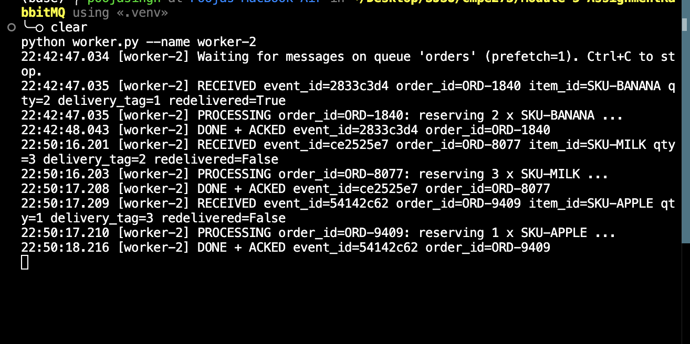 | 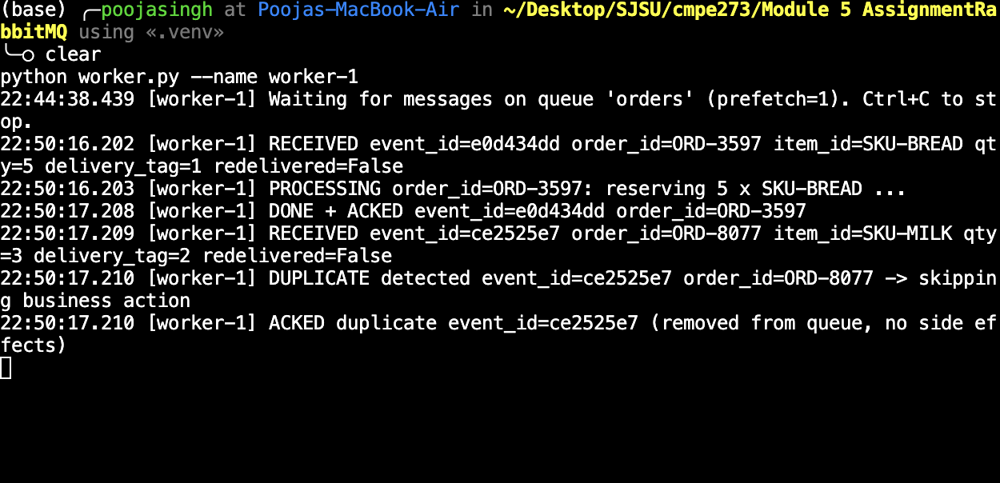 |

## Reflection

**Why can a message be delivered more than once, and how does idempotent handling help?**

RabbitMQ gives at-least-once delivery: it only forgets a message after it receives an ACK, so if a worker crashes, loses its connection, or finishes the work but dies before the ACK arrives, the broker cannot tell whether the work happened and redelivers the message to another consumer. Producers can also send the same event twice, for example when they retry after a publish timeout. Because of this, the consumer, not the broker, has to make processing safe to repeat. Idempotent handling does that by recording each processed `event_id` and checking it before the business action, so a redelivered or re-sent message is acknowledged and dropped instead of reserving inventory a second time. The result is effectively-once side effects on top of at-least-once delivery.
